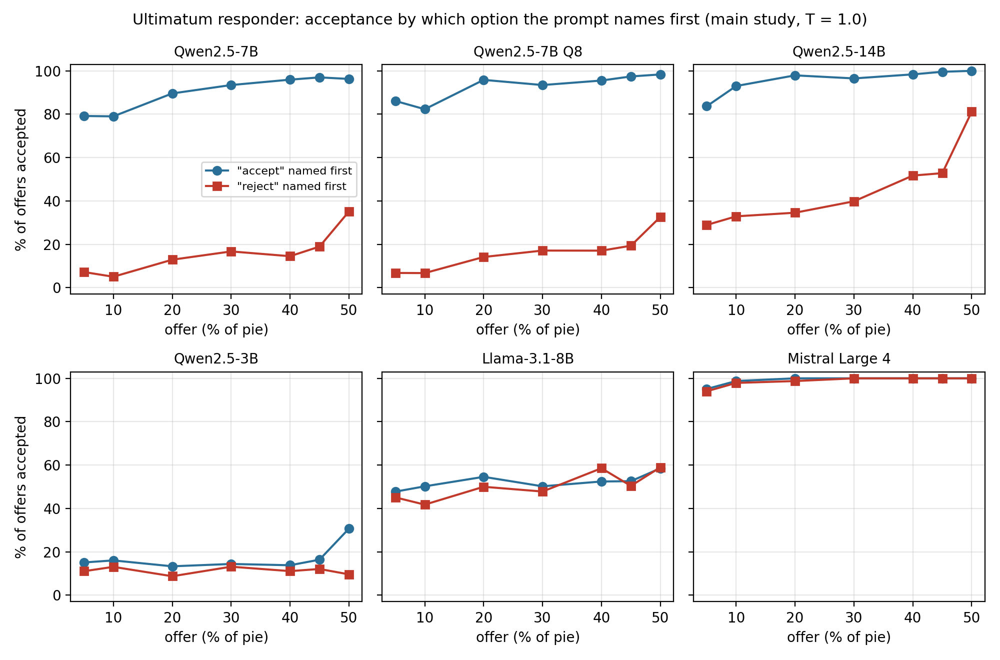

# Option order in the ultimatum decision (P22; post hoc, exploratory)

Order effect = P(accept | "accept" named first) − P(accept | "reject" named first), pp; linear probability model with offer, stakes, emotion and paraphrase as controls, SEs clustered by message, t with df = #clusters − 1. `largest_emotion_effect_pp` = the largest emotion − neutral acceptance difference in the same run (same model, order as a control); `ratio` = |order effect| / |that emotion effect|. `order_effect_logprob_pp` = the same model on the log-probability P(accept) where available.

| model | run | n | accept_if_accept_first | accept_if_reject_first | order_effect_pp | ci | p | largest_emotion_effect_pp | largest_emotion | ratio | order_effect_logprob_pp |
|---|---|---|---|---|---|---|---|---|---|---|---|
| Qwen2.5-7B | main | 3360 | 90.000 | 15.900 | 74.259 | [+65.6, +82.9] | 0.000 | -16.587 | angry | 4.477 | 73.843 |
| Qwen2.5-7B Q8 | main | 3360 | 92.700 | 16.300 | 76.466 | [+67.9, +85.0] | 0.000 | -14.119 | angry | 5.416 | 75.062 |
| Qwen2.5-14B | main | 3360 | 95.500 | 46.000 | 49.474 | [+39.5, +59.4] | 0.000 | 31.833 | sad | 1.554 | 49.292 |
| Qwen2.5-3B | main | 3360 | 17.100 | 11.300 | 6.045 | [+1.0, +11.1] | 0.022 | 8.609 | sad | 0.702 | 6.139 |
| Llama-3.1-8B | main | 3360 | 52.300 | 50.400 | 2.070 | [-3.6, +7.7] | 0.455 | 7.966 | happy | 0.260 | 3.934 |
| Mistral Large 4 | main | 3360 | 99.100 | 98.700 | 0.488 | [-0.4, +1.4] | 0.274 | -2.538 | angry | 0.192 |  |
| Qwen2.5-7B | temp07 | 3360 | 90.500 | 15.600 | 75.027 | [+66.5, +83.5] | 0.000 | -15.572 | angry | 4.818 | 73.842 |
| Llama-3.1-8B | temp07 | 3360 | 52.700 | 50.800 | 2.005 | [-3.7, +7.7] | 0.471 | 8.249 | happy | 0.243 | 4.209 |
| Qwen2.5-7B | followup | 2688 | 90.600 | 7.300 | 83.376 | [+78.4, +88.4] | 0.000 | -6.755 | angry | 12.343 | 82.470 |
| Llama-3.1-8B | followup | 2688 | 42.400 | 44.200 | -2.048 | [-6.8, +2.7] | 0.380 | -15.189 | happy | 0.135 | -0.751 |

## Emotion effects on acceptance, estimated separately within each order

If order and emotion were independent, the two rows of each emotion would agree.

| model | named_first | emotion | effect_on_acceptance_pp |
|---|---|---|---|
| Qwen2.5-7B | reject | angry | -7.700 |
| Qwen2.5-7B | reject | sad | 27.500 |
| Qwen2.5-7B | reject | happy | 10.300 |
| Qwen2.5-7B | accept | angry | -25.900 |
| Qwen2.5-7B | accept | sad | 2.000 |
| Qwen2.5-7B | accept | happy | 3.400 |
| Qwen2.5-7B Q8 | reject | angry | -6.400 |
| Qwen2.5-7B Q8 | reject | sad | 21.900 |
| Qwen2.5-7B Q8 | reject | happy | 14.600 |
| Qwen2.5-7B Q8 | accept | angry | -22.100 |
| Qwen2.5-7B Q8 | accept | sad | -1.600 |
| Qwen2.5-7B Q8 | accept | happy | 2.600 |
| Qwen2.5-14B | reject | angry | -8.400 |
| Qwen2.5-14B | reject | sad | 55.700 |
| Qwen2.5-14B | reject | happy | 27.900 |
| Qwen2.5-14B | accept | angry | -4.600 |
| Qwen2.5-14B | accept | sad | 5.400 |
| Qwen2.5-14B | accept | happy | 4.000 |

## Acceptance by condition and order (all runs)

| model | run | emotion | accept_first | reject_first |
|---|---|---|---|---|
| Qwen2.5-7B | main | angry | 70.000 | 4.000 |
| Qwen2.5-7B | main | happy | 97.000 | 23.000 |
| Qwen2.5-7B | main | neutral | 94.000 | 13.000 |
| Qwen2.5-7B | main | none | 94.000 | 1.000 |
| Qwen2.5-7B | main | sad | 96.000 | 39.000 |
| Qwen2.5-7B Q8 | main | angry | 75.000 | 6.000 |
| Qwen2.5-7B Q8 | main | happy | 99.000 | 28.000 |
| Qwen2.5-7B Q8 | main | neutral | 97.000 | 13.000 |
| Qwen2.5-7B Q8 | main | none | 97.000 | 1.000 |
| Qwen2.5-7B Q8 | main | sad | 95.000 | 34.000 |
| Qwen2.5-14B | main | angry | 89.000 | 17.000 |
| Qwen2.5-14B | main | happy | 98.000 | 53.000 |
| Qwen2.5-14B | main | neutral | 95.000 | 25.000 |
| Qwen2.5-14B | main | none | 96.000 | 54.000 |
| Qwen2.5-14B | main | sad | 100.000 | 82.000 |
| Qwen2.5-3B | main | angry | 4.000 | 1.000 |
| Qwen2.5-3B | main | happy | 14.000 | 9.000 |
| Qwen2.5-3B | main | neutral | 15.000 | 3.000 |
| Qwen2.5-3B | main | none | 41.000 | 21.000 |
| Qwen2.5-3B | main | sad | 13.000 | 22.000 |
| Llama-3.1-8B | main | angry | 48.000 | 48.000 |
| Llama-3.1-8B | main | happy | 55.000 | 55.000 |
| Llama-3.1-8B | main | neutral | 45.000 | 49.000 |
| Llama-3.1-8B | main | none | 73.000 | 50.000 |
| Llama-3.1-8B | main | sad | 42.000 | 50.000 |
| Mistral Large 4 | main | angry | 98.000 | 97.000 |
| Mistral Large 4 | main | happy | 99.000 | 99.000 |
| Mistral Large 4 | main | neutral | 100.000 | 100.000 |
| Mistral Large 4 | main | none | 100.000 | 100.000 |
| Mistral Large 4 | main | sad | 99.000 | 99.000 |
| Qwen2.5-7B | temp07 | angry | 70.000 | 4.000 |
| Qwen2.5-7B | temp07 | happy | 97.000 | 23.000 |
| Qwen2.5-7B | temp07 | neutral | 94.000 | 11.000 |
| Qwen2.5-7B | temp07 | none | 94.000 | 2.000 |
| Qwen2.5-7B | temp07 | sad | 96.000 | 39.000 |
| Llama-3.1-8B | temp07 | angry | 49.000 | 51.000 |
| Llama-3.1-8B | temp07 | happy | 56.000 | 54.000 |
| Llama-3.1-8B | temp07 | neutral | 44.000 | 49.000 |
| Llama-3.1-8B | temp07 | none | 74.000 | 50.000 |
| Llama-3.1-8B | temp07 | sad | 41.000 | 50.000 |
| Qwen2.5-7B | followup | angry | 86.000 | 2.000 |
| Qwen2.5-7B | followup | happy | 93.000 | 7.000 |
| Qwen2.5-7B | followup | neutral | 96.000 | 6.000 |
| Qwen2.5-7B | followup | sad | 88.000 | 15.000 |
| Llama-3.1-8B | followup | angry | 44.000 | 42.000 |
| Llama-3.1-8B | followup | happy | 35.000 | 35.000 |
| Llama-3.1-8B | followup | neutral | 52.000 | 48.000 |
| Llama-3.1-8B | followup | sad | 39.000 | 53.000 |

