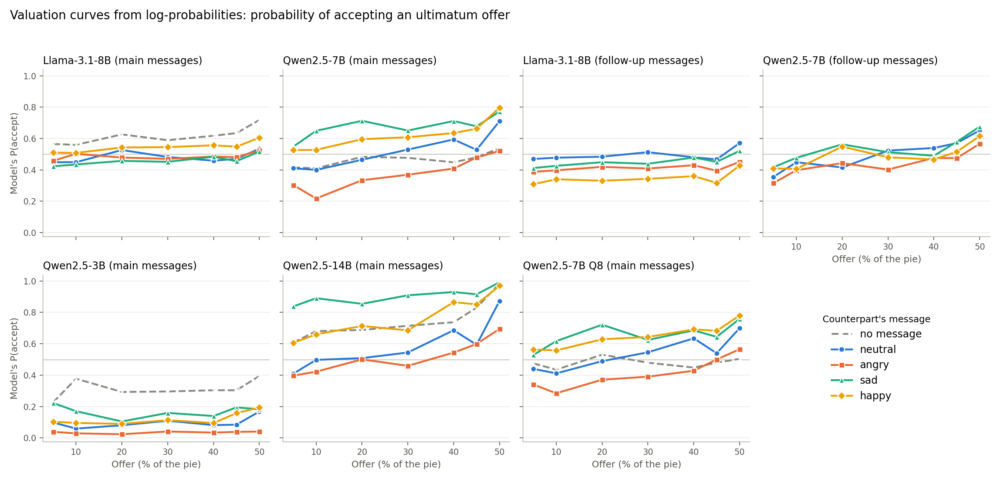

# The model's valuation curve: log-probabilities as a value signal (exploratory, post hoc; P18)

Each model's probability of answering "accept" in the ultimatum game (S1), read from its log-probabilities on the same prompts and seeds as the choices. Mixed model on logit P(accept) with message and message×paraphrase random intercepts; t with df = #messages − #emotions; Holm across all emotion×run tests (no-message rows excluded from the family).
- **value shift**: change in logit P(accept) at a 30% offer vs a neutral message (> 0 = the same offer is more acceptable).
- **gain shift**: change in the slope on the offer (logit per unit share; > 0 = more sensitive to fairness).
- **indifference offer**: offer at which P(accept) = .5, the MAO analogue (neutral → emotion), and its shift (parametric bootstrap). Reported only when the neutral curve rises reliably with the offer and both crossings fall between 0% and 55%; otherwise "not identified" (flat or never-crossing curves).

**Value shifts surviving Holm (2 of 21):** Llama-3.1-8B (follow-up messages) happy -0.79; Qwen2.5-14B (main messages) sad +4.08

| run | emotion | value_shift_logit | p_value_holm | gain_shift | p_gain_holm | indifference_offer_pct | indiff_shift_pp |
|---|---|---|---|---|---|---|---|
| Llama-3.1-8B (main messages) | angry | -0.07 [-0.50, +0.36] | 1.000 | +0.01 [-0.54, +0.55] | 1.000 | not identified |  |
| Llama-3.1-8B (main messages) | sad | -0.13 [-0.56, +0.30] | 1.000 | +0.22 [-0.33, +0.76] | 1.000 | not identified |  |
| Llama-3.1-8B (main messages) | happy | +0.32 [-0.11, +0.75] | 1.000 | +0.23 [-0.32, +0.78] | 1.000 | not identified |  |
| Llama-3.1-8B (main messages) | none | +1.06 [+0.61, +1.52] |  | +1.15 [+0.60, +1.69] |  | not identified |  |
| Qwen2.5-7B (main messages) | angry | -2.16 [-3.98, -0.33] | 0.373 | -0.07 [-3.82, +3.68] | 1.000 | 22 → 51 | +29.4 [+6.2, +56.6] |
| Qwen2.5-7B (main messages) | sad | +1.68 [-0.15, +3.50] | 0.913 | -3.72 [-7.47, +0.03] | 0.953 | not identified |  |
| Qwen2.5-7B (main messages) | happy | +1.31 [-0.51, +3.14] | 1.000 | -2.05 [-5.80, +1.70] | 1.000 | not identified |  |
| Qwen2.5-7B (main messages) | none | -1.04 [-2.97, +0.88] |  | -3.13 [-6.86, +0.59] |  | 22 → 40 | +18.3 [-18.1, +63.1] |
| Llama-3.1-8B (follow-up messages) | angry | -0.46 [-0.74, -0.18] | 0.059 | -0.03 [-0.48, +0.42] | 1.000 | not identified |  |
| Llama-3.1-8B (follow-up messages) | sad | -0.25 [-0.53, +0.03] | 0.966 | +0.26 [-0.19, +0.71] | 1.000 | not identified |  |
| Llama-3.1-8B (follow-up messages) | happy | -0.79 [-1.07, -0.51] | 0.000 | +0.15 [-0.30, +0.60] | 1.000 | not identified |  |
| Qwen2.5-7B (follow-up messages) | angry | -1.08 [-3.56, +1.40] | 1.000 | -2.86 [-6.79, +1.08] | 1.000 | 26 → 42 | +16.5 [-17.5, +52.7] |
| Qwen2.5-7B (follow-up messages) | sad | +0.38 [-2.10, +2.86] | 1.000 | -3.50 [-7.43, +0.44] | 1.000 | 26 → 17 | -9.1 [-49.9, +26.8] |
| Qwen2.5-7B (follow-up messages) | happy | -0.20 [-2.68, +2.28] | 1.000 | -3.98 [-7.91, -0.04] | 0.953 | 26 → 27 | +0.9 [-43.6, +44.2] |
| Qwen2.5-3B (main messages) | angry | -1.06 [-1.94, -0.18] | 0.345 | -1.01 [-2.90, +0.89] | 1.000 | not identified |  |
| Qwen2.5-3B (main messages) | sad | +0.83 [-0.05, +1.71] | 0.869 | -1.19 [-3.08, +0.71] | 1.000 | not identified |  |
| Qwen2.5-3B (main messages) | happy | +0.48 [-0.40, +1.35] | 1.000 | -0.07 [-1.97, +1.83] | 1.000 | not identified |  |
| Qwen2.5-3B (main messages) | none | +2.51 [+1.59, +3.44] |  | +0.98 [-0.91, +2.87] |  | not identified |  |
| Qwen2.5-14B (main messages) | angry | -1.19 [-2.97, +0.60] | 1.000 | -3.10 [-6.16, -0.04] | 0.953 | 19 → 30 | +11.1 [-7.9, +30.5] |
| Qwen2.5-14B (main messages) | sad | +4.08 [+2.30, +5.87] | 0.003 | -7.04 [-10.10, -3.98] | 0.003 | not identified |  |
| Qwen2.5-14B (main messages) | happy | +2.35 [+0.57, +4.14] | 0.226 | -2.12 [-5.18, +0.94] | 1.000 | not identified |  |
| Qwen2.5-14B (main messages) | none | +2.00 [+0.11, +3.89] |  | -0.86 [-3.90, +2.18] |  | not identified |  |
| Qwen2.5-7B Q8 (main messages) | angry | -2.05 [-3.94, -0.17] | 0.515 | -0.37 [-4.14, +3.40] | 1.000 | 17 → 50 | +33.9 [+4.2, +71.4] |
| Qwen2.5-7B Q8 (main messages) | sad | +1.10 [-0.79, +2.99] | 1.000 | -2.78 [-6.55, +0.99] | 1.000 | not identified |  |
| Qwen2.5-7B Q8 (main messages) | happy | +1.47 [-0.42, +3.35] | 1.000 | -1.95 [-5.72, +1.82] | 1.000 | not identified |  |
| Qwen2.5-7B Q8 (main messages) | none | -1.14 [-3.13, +0.85] |  | -3.37 [-7.11, +0.38] |  | 17 → 41 | +24.6 [-39.7, +119.1] |

## Is the signal valid? Calibration against the sampled choices

At T = 1.0 a choice is a draw from the model's distribution, so the accept rate in each P(accept) bin should match the mean P(accept) if the log-probability reflects the decision.

**Llama-3.1-8B (main messages)**: r(P(accept), sampled choice) = 0.53

| p_accept_lp | n | mean_p | accept_rate |
|---|---|---|---|
| (-0.001, 0.1] | 126 | 0.071 | 0.000 |
| (0.1, 0.3] | 545 | 0.198 | 0.176 |
| (0.3, 0.5] | 1044 | 0.407 | 0.392 |
| (0.5, 0.7] | 752 | 0.587 | 0.602 |
| (0.7, 0.9] | 577 | 0.792 | 0.782 |
| (0.9, 1.0] | 316 | 0.949 | 1.000 |

**Qwen2.5-7B (main messages)**: r(P(accept), sampled choice) = 0.95

| p_accept_lp | n | mean_p | accept_rate |
|---|---|---|---|
| (-0.001, 0.1] | 1371 | 0.008 | 0.000 |
| (0.1, 0.3] | 124 | 0.187 | 0.153 |
| (0.3, 0.5] | 87 | 0.392 | 0.425 |
| (0.5, 0.7] | 64 | 0.588 | 0.547 |
| (0.7, 0.9] | 138 | 0.821 | 0.783 |
| (0.9, 1.0] | 1576 | 0.994 | 1.000 |

**Llama-3.1-8B (follow-up messages)**: r(P(accept), sampled choice) = 0.46

| p_accept_lp | n | mean_p | accept_rate |
|---|---|---|---|
| (-0.001, 0.1] | 93 | 0.083 | 0.000 |
| (0.1, 0.3] | 832 | 0.201 | 0.221 |
| (0.3, 0.5] | 821 | 0.388 | 0.396 |
| (0.5, 0.7] | 509 | 0.612 | 0.591 |
| (0.7, 0.9] | 398 | 0.779 | 0.804 |
| (0.9, 1.0] | 35 | 0.938 | 1.000 |

**Qwen2.5-7B (follow-up messages)**: r(P(accept), sampled choice) = 0.95

| p_accept_lp | n | mean_p | accept_rate |
|---|---|---|---|
| (-0.001, 0.1] | 1211 | 0.010 | 0.000 |
| (0.1, 0.3] | 118 | 0.184 | 0.229 |
| (0.3, 0.5] | 49 | 0.400 | 0.388 |
| (0.5, 0.7] | 52 | 0.628 | 0.462 |
| (0.7, 0.9] | 99 | 0.819 | 0.747 |
| (0.9, 1.0] | 1159 | 0.994 | 1.000 |

**Qwen2.5-3B (main messages)**: r(P(accept), sampled choice) = 0.87

| p_accept_lp | n | mean_p | accept_rate |
|---|---|---|---|
| (-0.001, 0.1] | 2583 | 0.009 | 0.000 |
| (0.1, 0.3] | 200 | 0.181 | 0.165 |
| (0.3, 0.5] | 118 | 0.414 | 0.407 |
| (0.5, 0.7] | 117 | 0.608 | 0.641 |
| (0.7, 0.9] | 113 | 0.809 | 0.814 |
| (0.9, 1.0] | 229 | 0.974 | 1.000 |

**Qwen2.5-14B (main messages)**: r(P(accept), sampled choice) = 0.94

| p_accept_lp | n | mean_p | accept_rate |
|---|---|---|---|
| (-0.001, 0.1] | 787 | 0.007 | 0.000 |
| (0.1, 0.3] | 114 | 0.210 | 0.202 |
| (0.3, 0.5] | 67 | 0.415 | 0.388 |
| (0.5, 0.7] | 101 | 0.606 | 0.663 |
| (0.7, 0.9] | 152 | 0.815 | 0.796 |
| (0.9, 1.0] | 2139 | 0.993 | 1.000 |

**Qwen2.5-7B Q8 (main messages)**: r(P(accept), sampled choice) = 0.95

| p_accept_lp | n | mean_p | accept_rate |
|---|---|---|---|
| (-0.001, 0.1] | 1313 | 0.007 | 0.000 |
| (0.1, 0.3] | 131 | 0.197 | 0.229 |
| (0.3, 0.5] | 75 | 0.415 | 0.373 |
| (0.5, 0.7] | 95 | 0.601 | 0.484 |
| (0.7, 0.9] | 133 | 0.820 | 0.835 |
| (0.9, 1.0] | 1613 | 0.994 | 1.000 |
