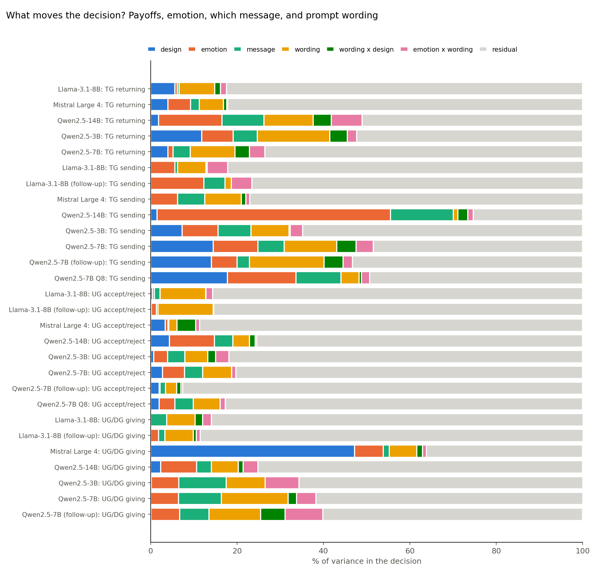

# Wording vs emotion: what moves the decision? (exploratory, post hoc; P19)

Sequential increments in **adjusted** R² (% of variance, corrected for the number of parameters, so a factor with many levels gets no credit for chance) in this order: design (payoffs) → emotion (3 df) → message within emotion → prompt wording (4 paraphrases, 3 df: the like-for-like comparison with emotion) → wording × payoffs → emotion × wording → residual (sampling noise at T = 1.0). Small negative values = nothing beyond chance. No-message trials excluded. S1 outcome = accept (0/1); S2/S3 = share. `wording_range_pp` = max − min of the four paraphrase means (neutral messages); `emotion_max_pp` = largest |emotion − neutral| difference.

- **Wording (3 df) explains more variance than emotion (3 df) in 21 of 28 model × game combinations.**
- Median share of variance: emotion 6.1%, message within emotion 4.1%, wording 6.7% (plus 1.2% wording × payoffs), emotion × wording 1.9%.
- Median spread across paraphrases 18 pp vs median largest emotion effect 12 pp.

| run | test | n | design | emotion | message | wording | wording x design | emotion x wording | residual | wording_range_pp | emotion_max_pp |
|---|---|---|---|---|---|---|---|---|---|---|---|
| Llama-3.1-8B | UG accept/reject | 2688 | 0.500 | 0.400 | 1.300 | 10.600 | 0.000 | 1.500 | 85.700 | 48.800 | 7.900 |
| Llama-3.1-8B | UG/DG giving | 768 | -0.200 | -0.100 | 3.700 | 6.600 | 1.700 | 2.000 | 86.300 | 25.200 | 4.300 |
| Llama-3.1-8B | TG returning | 1152 | 5.600 | 0.500 | 0.400 | 8.200 | 1.300 | 1.400 | 82.400 | 14.900 | 5.500 |
| Llama-3.1-8B | TG sending | 384 | -0.200 | 5.600 | 0.600 | 6.600 | 0.200 | 4.800 | 82.400 | 30.000 | 14.500 |
| Qwen2.5-7B | UG accept/reject | 2688 | 2.800 | 5.100 | 4.200 | 6.700 | -0.000 | 1.000 | 80.200 | 23.800 | 15.200 |
| Qwen2.5-7B | UG/DG giving | 768 | -0.000 | 6.400 | 10.000 | 15.400 | 1.900 | 4.500 | 61.800 | 12.100 | 5.800 |
| Qwen2.5-7B | TG returning | 1152 | 4.000 | 1.200 | 4.000 | 10.300 | 3.400 | 3.500 | 73.600 | 12.200 | 3.200 |
| Qwen2.5-7B | TG sending | 384 | 14.500 | 10.400 | 6.000 | 12.100 | 4.500 | 3.900 | 48.500 | 16.800 | 12.500 |
| Mistral Large 4 | UG accept/reject | 2688 | 3.400 | 0.600 | 0.200 | 1.900 | 4.300 | 0.900 | 88.600 | 0.600 | 2.500 |
| Mistral Large 4 | UG/DG giving | 768 | 47.200 | 6.700 | 1.400 | 6.400 | 1.300 | 0.900 | 36.200 | 10.800 | 16.300 |
| Mistral Large 4 | TG returning | 1152 | 4.000 | 5.200 | 2.100 | 5.600 | 0.800 | 0.200 | 82.100 | 19.700 | 13.800 |
| Mistral Large 4 | TG sending | 384 | -0.200 | 6.200 | 6.300 | 8.500 | 1.000 | 0.900 | 77.300 | 12.500 | 11.800 |
| Qwen2.5-3B | UG accept/reject | 2688 | 0.700 | 3.200 | 4.000 | 5.300 | 1.800 | 3.000 | 81.900 | 25.600 | 8.600 |
| Qwen2.5-3B | UG/DG giving | 768 | 0.100 | 6.400 | 11.000 | 9.000 | -0.100 | 7.800 | 65.700 | 27.100 | 16.200 |
| Qwen2.5-3B | TG returning | 1152 | 11.800 | 7.300 | 5.600 | 16.800 | 4.100 | 2.200 | 52.300 | 47.500 | 18.500 |
| Qwen2.5-3B | TG sending | 384 | 7.300 | 8.300 | 7.600 | 8.800 | 0.300 | 2.800 | 64.800 | 35.000 | 22.700 |
| Qwen2.5-14B | UG accept/reject | 2688 | 4.400 | 10.400 | 4.300 | 3.900 | 1.300 | 0.300 | 75.400 | 27.400 | 32.300 |
| Qwen2.5-14B | UG/DG giving | 768 | 2.300 | 8.300 | 3.400 | 6.300 | 1.100 | 3.500 | 75.100 | 7.200 | 6.100 |
| Qwen2.5-14B | TG returning | 1152 | 1.900 | 14.700 | 9.700 | 11.400 | 4.200 | 7.100 | 51.100 | 14.100 | 6.300 |
| Qwen2.5-14B | TG sending | 384 | 1.500 | 54.000 | 14.500 | 1.100 | 2.300 | 1.200 | 25.300 | 7.500 | 20.300 |
| Qwen2.5-7B Q8 | UG accept/reject | 2688 | 2.000 | 3.600 | 4.300 | 6.200 | -0.000 | 1.200 | 82.700 | 22.600 | 12.600 |
| Qwen2.5-7B Q8 | TG sending | 384 | 17.800 | 15.900 | 10.400 | 4.200 | 0.500 | 1.900 | 49.300 | 5.100 | 15.900 |
| Llama-3.1-8B (follow-up) | UG accept/reject | 2688 | 0.200 | 1.100 | 0.400 | 12.800 | 0.100 | -0.000 | 85.300 | 45.800 | 15.200 |
| Llama-3.1-8B (follow-up) | UG/DG giving | 768 | -0.300 | 1.800 | 1.500 | 6.600 | 0.700 | 0.900 | 88.800 | 27.300 | 8.300 |
| Llama-3.1-8B (follow-up) | TG sending | 384 | -0.100 | 12.400 | 4.800 | 1.500 | -0.600 | 4.700 | 77.200 | 14.600 | 21.500 |
| Qwen2.5-7B (follow-up) | UG accept/reject | 2688 | 2.000 | 0.200 | 1.200 | 2.600 | 0.900 | 0.400 | 92.600 | 15.500 | 5.200 |
| Qwen2.5-7B (follow-up) | UG/DG giving | 768 | 0.100 | 6.600 | 6.800 | 12.000 | 5.600 | 8.800 | 60.100 | 1.900 | 5.600 |
| Qwen2.5-7B (follow-up) | TG sending | 384 | 14.100 | 5.900 | 2.900 | 17.200 | 4.400 | 2.200 | 53.300 | 20.200 | 9.400 |
